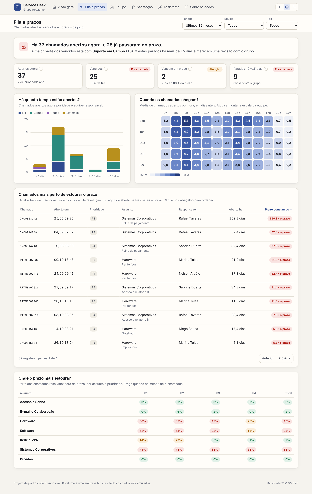
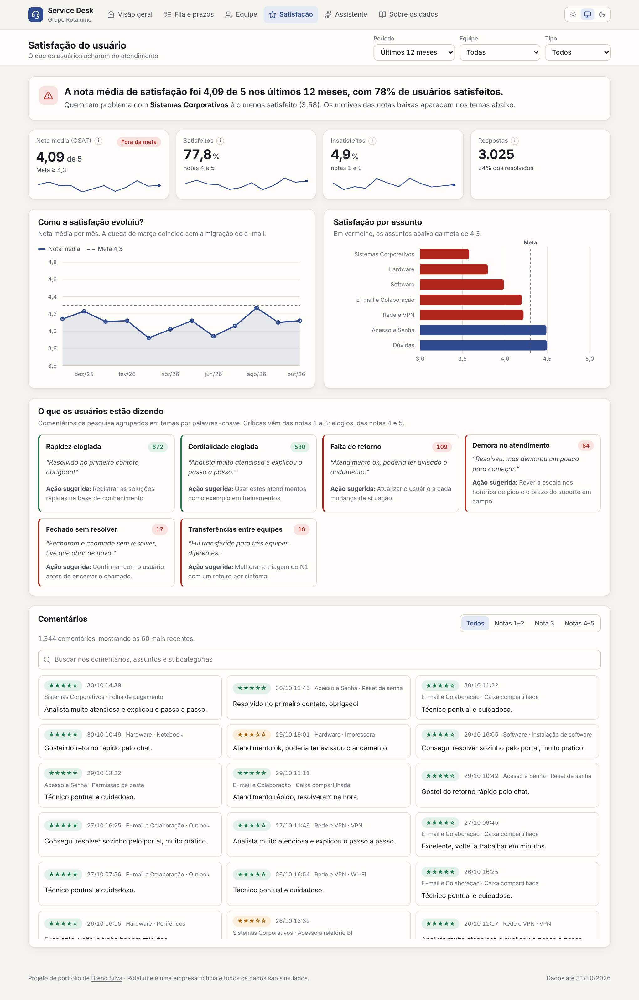

# Painel de Service Desk — Grupo Rotalume

> Dashboard interativo do Service Desk interno de TI de uma empresa **fictícia** (Grupo Rotalume), em React + TypeScript, sem backend. Acompanha prazos (SLA), fila, desempenho da equipe e satisfação dos usuários, e traz um assistente que responde perguntas comuns com os próprios dados do painel.


## O que o painel responde

- Os chamados estão sendo atendidos e resolvidos no prazo?
- O que está na fila agora, há quanto tempo, e o que vence primeiro?
- Em que horários os chamados chegam, para montar a escala da equipe?
- Como cada analista está em rapidez, reabertura e satisfação?
- Do que os usuários mais reclamam, e qual ação atacar primeiro?



## Por que essas escolhas

- **Métricas de ITSM (ITIL 4)**: SLA de resposta e de resolução por prioridade, FCR (resolução no primeiro contato), reabertura e CSAT. É o vocabulário de qualquer central de serviço.
- **Mediana em vez de média no tempo de resolução**: poucos chamados parados por semanas distorcem a média; a mediana mostra o tempo típico.
- **Fila com "prazo consumido"**: em vez de só contar abertos, cada chamado mostra quanto do prazo já gastou, para agir antes de vencer.
- **Comentários agrupados em temas com ação sugerida**: transforma a pesquisa de satisfação em um plano de melhoria, não só em uma nota.
- **Assistente sem serviços externos**: as respostas são calculadas no navegador a partir dos mesmos dados dos gráficos. Não há chave de API no código e nenhum número é inventado.
- **Eventos simulados** (migração de e-mail, portal de autoatendimento, queda da VPN): testam se os indicadores mostram mudanças reais de processo, não só ruído.
- **React + TypeScript com dados gerados no navegador** (semente fixa, reprodutível), publicado como site estático. Cada tela abre com uma manchete que diz o resultado em uma frase, antes dos gráficos.



## Dados

Todos os dados são fictícios, gerados no navegador ao carregar a página. Os eventos simulados e as fórmulas estão na aba **"Sobre os dados"** do próprio painel.

## Deploy

Aplicação estática feita com Vite. Na Vercel, basta importar o repositório: o framework é detectado sozinho (build `npm run build`, saída `dist/`). O `vercel.json` redireciona as rotas para o `index.html`, então links diretos como `/fila` funcionam.

**Localmente:**
```bash
npm install
npm run dev       # desenvolvimento
npm run build     # gera dist/
```

A versão anterior, em HTML puro com Chart.js e assistente ligado ao Claude, está preservada em `legado.html`.

## Stack

React 19 + TypeScript, Vite, React Router, [Recharts](https://recharts.org/) e ícones Lucide. O tema claro/escuro usa variáveis CSS e os gráficos leem as mesmas cores, então mudam junto com o tema. Os filtros ficam salvos no navegador. A identidade visual é compartilhada com os outros painéis da Rotalume.
