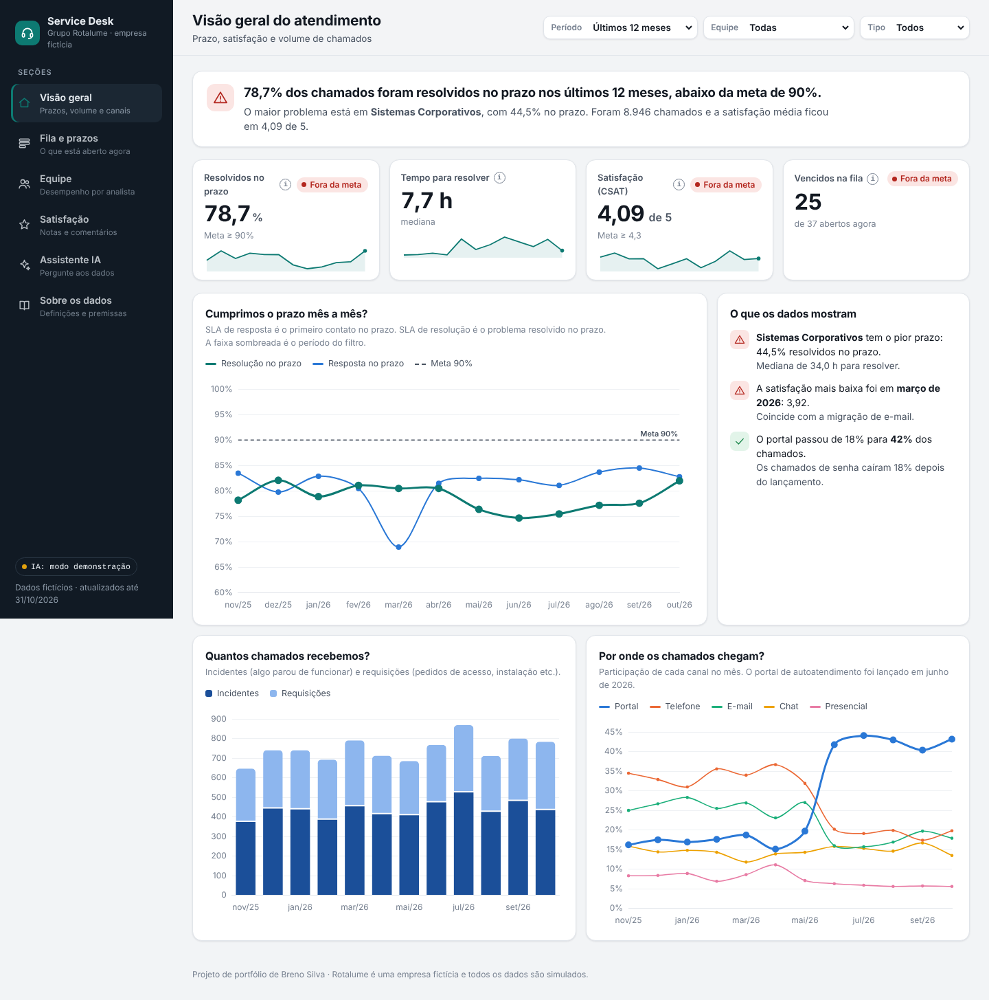
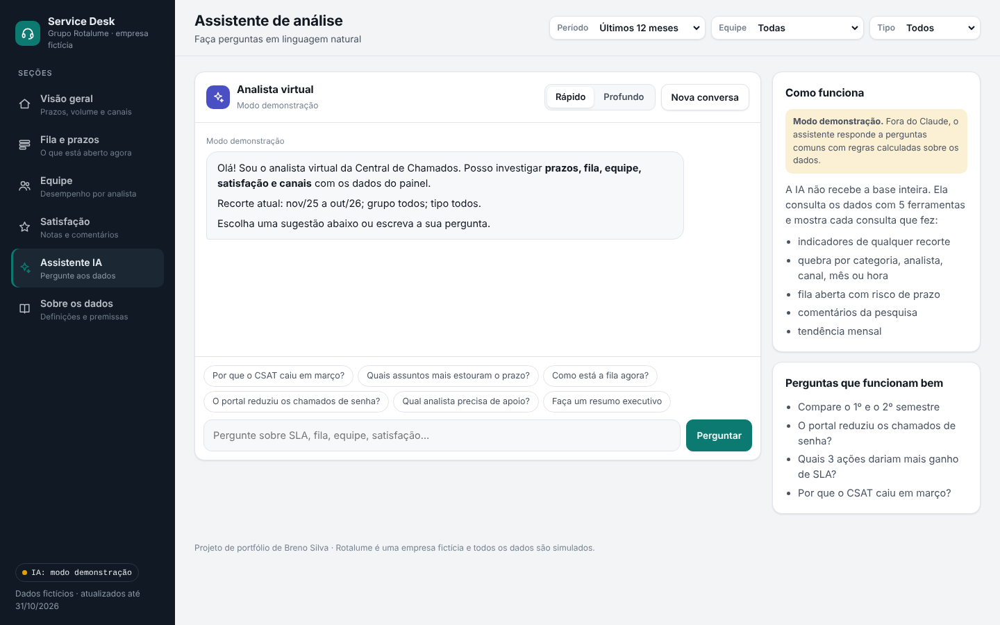

# Painel de Service Desk com IA — Grupo Rotalume

> Dashboard interativo de Service Desk de uma empresa **fictícia** (Grupo Rotalume), em HTML/CSS/JS puro, sem backend, com um **assistente de IA** que responde perguntas sobre os próprios dados do painel.



## O que o painel responde

- Estamos cumprindo o SLA de resposta e resolução?
- O que está na fila e há quanto tempo está aberto?
- Como cada analista/equipe está performando (reabertura, FCR)?
- O que os usuários mais reclamam (temas dos comentários, CSAT)?

## O assistente de IA

A aba **Assistente IA** usa a capacidade de *tool use* do Claude: em vez de um chatbot genérico, a IA chama 5 "ferramentas" que consultam diretamente os dados daquela tela — indicadores, quebra por dimensão, fila aberta, comentários e tendência. Cada resposta mostra quais consultas foram feitas, então é possível rastrear de onde veio cada número.



- **Dentro de um ambiente Claude** (ex.: Claude Artifacts), a IA usa a conta de quem está vendo o painel — nenhum custo recai sobre quem publicou.
- **Fora do Claude (Vercel, GitHub Pages etc.)**, o assistente roda em **modo demonstração**: respostas calculadas no próprio navegador, sem chamada de API e sem chave alguma no código.

## Por que essas escolhas

- **IA com function-calling sobre os dados do próprio painel**: em vez de alucinar números, cada resposta é rastreável a uma consulta real feita sobre o dataset em memória. É o mesmo padrão (tool use) usado em agentes de IA de produção.
- **Degradação graciosa (modo demonstração)**: o painel detecta se a capacidade de IA está disponível e avisa claramente qual modo está ativo, em vez de quebrar silenciosamente fora do Claude.
- **Métricas de ITSM**: SLA de resposta/resolução, FCR (resolução no primeiro contato), taxa de reabertura e CSAT — vocabulário padrão de Service Desk (ITIL 4).
- **Eventos simulados** (lançamento de portal de autoatendimento, migração de e-mail, instabilidade de VPN): testam se os indicadores refletem mudanças reais de processo, não só ruído aleatório.
- **Arquivo único, sem build**: HTML/CSS/JS em um só arquivo (`index.html`), dados sintéticos gerados no navegador (semente fixa) e gráficos via Chart.js por CDN — publicável em qualquer hospedagem estática.

## Dados

Todos os dados são fictícios, gerados no navegador ao carregar a página. Os eventos simulados estão detalhados na aba **"Sobre os dados"** do próprio painel.

## Deploy

Projeto 100% estático — basta apontar a hospedagem para a raiz do repositório.

**Vercel:**
```bash
npm i -g vercel   # se ainda não tiver
vercel --prod
```
Ou: importar o repositório direto em [vercel.com/new](https://vercel.com/new) — nenhuma configuração de build é necessária (é um `index.html` puro).

**Localmente:** abra `index.html` no navegador, ou sirva com qualquer servidor estático (`npx serve .`).

## Stack

HTML5, CSS3 (custom properties para tema claro/escuro), JavaScript (ES6+), [Chart.js 4.4.1](https://www.chartjs.org/), Claude (tool use / function calling) para o assistente de IA.
